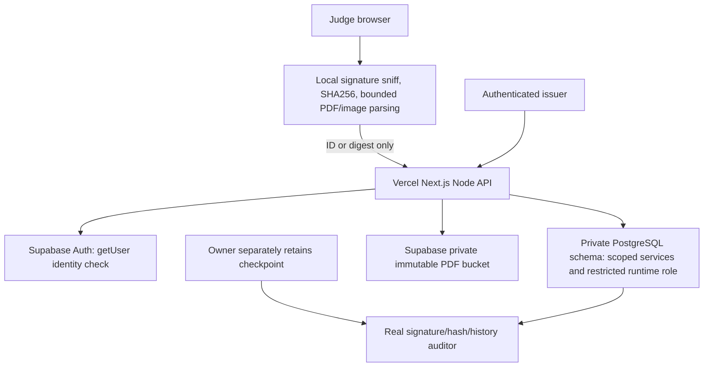

# Evidence and trust

Five module boundaries: foundation/access (`src/server/auth.ts`, schema); issuance/artifacts (`lifecycle.ts`, `pdf.ts`, `storage.ts`); proof/lifecycle (`src/lib/proof.ts`, appendEvent); public verification (`verification.ts`, local parser and result components); experience/release (UI, scripts, reports).

Issuance reserves cryptographically random certificate ID (16 bytes), nonce (32 bytes), timestamps and normalized input fingerprint. A fenced two-minute processing lease chooses the original. PDF/Storage calls occur outside DB transactions. Immutable Storage upload uses no overwrite. A stored fingerprint guards retries. A short transaction rechecks actor authority, locks the request and ledger head, commits private payload/artifact/manifest/ISSUE/head and scrubs the request payload. PostgreSQL and Storage do not share an atomic transaction. Staged leftovers are recoverable and cleaned after a grace period.

Proof uses maintained canonicalize for RFC8785 JCS, UTF8 and domain separation: CP_PAYLOAD_V1, CP_MANIFEST_V1, CP_EVENT_V1, CP_CHECKPOINT_V1. Hashes are lowercase SHA256 hex. Ed25519 detached signatures use base64url. DER pkcs8/spki signing/key-ring configuration is base64. Decimal ledger sequences avoid JSON numeric precision loss. Genesis previous hash is 64 zeroes. Explicit nulls distinguish absent expiry/reason from inconsistent serialization.

One ordered signed ledger per issuer. Verification reads certificate, private payload, ledger events and head in a repeatable-read snapshot, verifies schemas/hashes/signatures/transitions/head/projections, then derives expiry and public projection. Reads are uncached. Full audit is bounded to 10,000 events; higher volume returns unavailable until incremental trusted auditing is implemented. Database indexes enforce unique issuance request keys, PDF hashes, ledger sequence and lifecycle event type per certificate.

Database-only history changes are caught by signatures and chain checks; rollback requires a remembered separately retained checkpoint. The same database cannot witness its own deletion. Owner-writable exports are not independent third-party witnesses. A fully compromised signing server/private key is outside this demonstration’s assurance. Independent institutional custody is future work.

Private-download authority is checked before a 60-second Storage URL is issued. Ordinary originals are private; only explicit fictional DemoAsset entries are public. A purge first blocks private downloads, removes Storage/private DB copies, then appends PII_PURGED. Failed deletion stays pending. Signed public fingerprints/status remain and may still be linkable.

Security: strict schemas/bounded JSON, origin checks, current Auth identity/membership checks, private schema with no anon/authenticated grants, restricted ledger privileges, durable salted abuse counters, no raw app request logging, same-origin browser APIs, no external font/CDN/parser requests. CSP requires Next inline bootstrap; it excludes remote scripts, embedded document frames, arbitrary connections and document scripting. pdf.js is used only for text/render APIs, never a viewer/scripting integration. Images/PDFs are processed inside a terminated, bounded worker. Font coverage is tested and unsupported glyphs fail explicitly.

Roadmap: trusted issuer onboarding and independent keys; bulk issuance; interoperable credentials; incremental checkpoint auditing and more capacity. Institutional operating/privacy review and higher hosting capacity may introduce future costs; these are outside the free fictional release.
