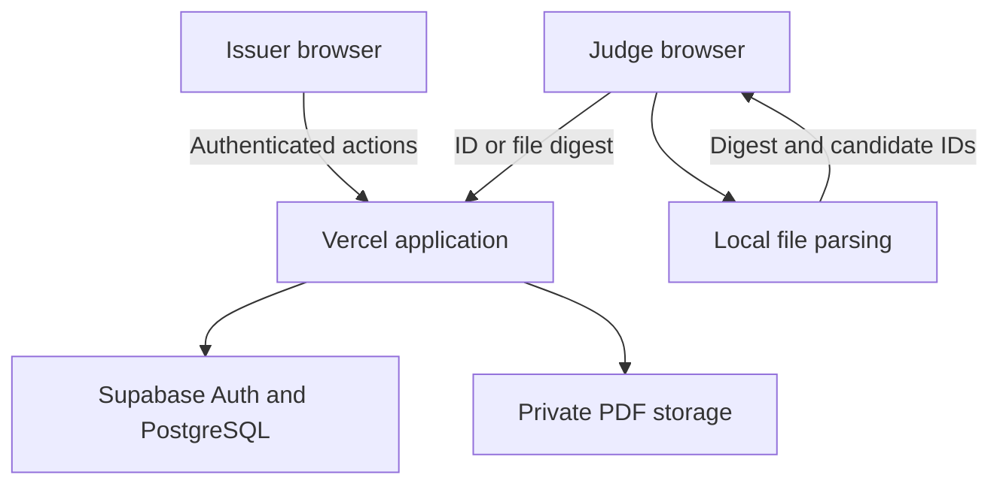

# CertiProof — complete build and public deployment prompt

Use this file on its own. Attach it to Codex with your project folder open and say: “Implement this specification completely, including deployment and verification of the public production URL. Continue until the release gates pass; tell me when an owner login or configuration step is needed.” Alternatively, copy the text between BEGIN PROMPT and END PROMPT.

This replaces the earlier local-only approach. One teammate operates one repository from one computer; Vercel and Supabase keep the deployed app available to other devices when that computer is off.

Free accounts to prepare:

| Account | Purpose | What you do |
|---|---|---|
| [GitHub Free](https://github.com/signup) | Store source and connect deployment | Use an existing personal account or create one. Keep the repository private unless the competition requires public source. |
| [Vercel Hobby](https://vercel.com/signup) | Host the website and server functions at an HTTPS vercel.app address | Sign in, choose Hobby for this noncommercial student demonstration, and connect only the intended repository. |
| [Supabase Free](https://supabase.com/dashboard) | Persistent PostgreSQL database, issuer login and private certificate storage | Create one Free project and keep its database password securely. Choose a nearby available region. |

Do not activate Pro trials, buy a domain, or add a payment card for this design. If a provider requires payment for a proposed step, stop that step and ask Codex to find a compatible free alternative. Free usage has limits; account eligibility and plans must be rechecked at implementation time. Initial installation, public hosting and live verification require internet. Supabase Free projects may pause after low activity over a week, so rehearse and check the project before judging.

The project does not need paid AI, cloud OCR, a blockchain wallet, SMS or an email-sending service. Your existing Codex access is separate from application hosting costs. Never paste passwords, OTPs, database passwords or private API/signing keys into chat; enter secrets in local environment files or provider settings when guided.

Prepared 13 October 2026. This is an implementation specification, not a finished application or a promise of competition results.

---

BEGIN PROMPT

You are the lead engineer implementing my complete project, CertiProof, from ONE teammate’s computer and ONE repository. Build the actual working application, integrate everything yourself, test it, fix defects, deploy it publicly and prepare it for a live demonstration to judges on their own devices. I am not very experienced with technology, so give me short, clear explanations and exact commands when I need to act.

Do not stop at a plan, UI mock-up, scaffold, architecture document or a list of things I should implement. Work through the complete project. Use sensible defaults and complete all unblocked work. Ask a question only when a genuinely missing decision prevents safe progress. Never claim an action or test was completed when it was not.

This is the current project specification. It replaces earlier five-teammate and local-only implementation instructions. There are no inter-teammate module dependencies to wait for. Keep clear internal modules in one repository, but one person must be able to build, operate and demonstrate the whole system.

## 1. Goal and exact problem statement

Project: “Tamper-Evident Digital Certificate Verification System.”

Problem: educational/training certificates are difficult for employers and institutions to verify efficiently.

Required capabilities:

1. Issue certificates with unique verification IDs or QR codes.
2. Verify certificate status without exposing unnecessary personal information.
3. Detect altered certificate data.
4. Maintain issuance and revocation records.
5. Demonstrate a hash-linked ledger OR a blockchain-based audit trail.

Required outcome: an issuer portal and a public verification page using fictional certificates.

Implement a signed, hash-linked ledger. A cryptocurrency network, token, wallet or on-chain transaction is not required. Use fictional institutions and fictional adult recipients. Certificates must visibly state “Demonstration — fictional certificate.”

Our aim is a convincing, usable and technically honest demonstration. We want judges to understand the problem, try their own supported input, see real results and understand why the result occurred. Do not promise a win or fabricate evidence to make the project appear stronger.

Priorities, in order: correct verification and privacy; a working public deployment with persistent data; a simple judge experience; complete required features; responsive/accessibility polish; useful extras.

## 2. Free services, public deployment and owner assistance

Use GitHub Free, Vercel Hobby and Supabase Free as the required hosted services, subject to their current eligibility and limits. Use a personal repository/account deployment suitable for one operator; do not add paid team seats. Retain repository privacy unless I request publication or competition rules require it. The website itself must be public.

No paid API, Pro trial, card-required dependency, purchased domain, paid database, external LLM, paid OCR, SMTP, SMS, blockchain RPC, monitoring subscription or analytics subscription may be required. Verify official pricing before adding anything. Keep normal demo usage within free quotas. Do not create extra accounts or artificial traffic to evade limits. Document limits rather than promising permanent unlimited free hosting.

Use Vercel for this full-stack Next.js application. GitHub Pages alone is static hosting and cannot run the required trusted signing/authentication/database server. Do not place private signing keys or privileged database keys in a Pages frontend. A separate Pages marketing site is unnecessary. If Vercel is unavailable or the project is ineligible for Hobby, complete the implementation and propose a verified free full-stack alternative before changing providers; never quietly deliver a static imitation.

Deployment of this fictional-data project is already requested. Use authorised account/CLI integrations where available and proceed through the release. Do not stop at deployment instructions if you can actually deploy. If owner login, account verification, a missing secret, or provider access is required, finish unblocked work and give one short, specific action request. Never claim to have deployed when access is unavailable.

Maintain EXTERNAL_SETUP.md with rows: step, service, why needed, exact owner action, safe configuration names, status and what you will do next. Reuse completed setup. Typical owner actions are:

1. Sign into/create GitHub, Vercel Hobby and Supabase Free, completing provider email/account verification directly.
2. Authorise the intended GitHub repository for Vercel; no unnecessary repository access.
3. Create the Free Supabase project and enter its connection strings and server credentials securely into the specified local/provider settings.
4. Complete Vercel CLI/browser login if the environment requires it.
5. Supply a truthful public support email only if desired; an in-app support/privacy queue is the default.
6. Open the actual production URL on a second device/network for a human cross-device check when physical access is unavailable to you.

Never request passwords, MFA codes, secrets or signing keys in conversation. Distinguish public Supabase URL/publishable key from privileged server credentials. If secrets are missing, identify their variable names and where the owner obtains/enters them; do not print their values. Supply .env.example with descriptions and no real secrets. Use dashboard entries or gitignored local configuration. Do not fabricate a deployed URL or untested “all done” claim.

Document these configuration entries, adapting names to the installed SDK only when necessary:

| Configuration | Who supplies it | Exposure |
|---|---|---|
| APP_ORIGIN | Actual stable production HTTPS domain | Non-secret; used in signed certificates/QR links |
| NEXT_PUBLIC_SUPABASE_URL | Supabase project dashboard | Public project URL |
| NEXT_PUBLIC_SUPABASE_PUBLISHABLE_KEY | Supabase project dashboard | Public key; permissions still enforced server-side/in the database |
| DATABASE_URL | Runtime role and documented pooler connection | Server secret; never in browser code |
| Migration connection, named for the installed Prisma version | Supabase connection settings and migration role | Owner/deployment migration secret, separate from ordinary runtime access |
| SUPABASE_SECRET_KEY or the documented legacy service-role variable | Supabase project settings | Privileged server/setup secret; never NEXT_PUBLIC |
| CERTIFICATE_SIGNING_PRIVATE_KEY_B64 | Generated once by a local setup tool | Persistent server secret with private owner backup |
| SIGNING_KEY_ID and TRUSTED_PUBLIC_KEYS_JSON | Setup tool and maintained key ring | Public verification material; historical keys retained |

Do not require the owner to understand cryptography or SQL to perform setup. Generate configuration templates/checks and explain each manual dashboard step in simple language. Secret-entry prompts must not echo sensitive values to terminal logs or capture them in screenshots.

## 3. Recommended stack and five internal modules

Use one Next.js application with TypeScript, App Router, React and the Node server runtime, deployed to Vercel. Prefer a supported compatible Node LTS, initially Node 24 LTS; record the tested local release and align Vercel's supported major version.

- UI: Tailwind CSS, shadcn/ui primitives, Lucide icons, React Hook Form and Zod.
- Authentication: Supabase Auth with its supported server-side rendering integration.
- Database: Supabase PostgreSQL with Prisma, version-matched migrations and transaction APIs.
- Files: Supabase private Storage for immutable original PDFs; no database on Vercel's filesystem.
- Integrity: Node crypto SHA-256/Ed25519 and RFC 8785-compatible canonicalization.
- Documents: pdf-lib, locally bundled licensed fonts and a maintained QR encoder.
- Judge file handling: browser Web Crypto, locally bundled PDF.js and a QR decoder such as jsQR.
- Quality checks: Vitest, Playwright and axe-core.

Pin mutually compatible stable versions and one npm lockfile. Consult official documentation for the installed versions; do not mix configuration across Prisma/Next.js major versions. Verify the production build early. Small substitutions are allowed for demonstrated compatibility problems, with an explanation and unchanged cost/security/functionality requirements.

Keep five internal modules so future team development is straightforward, while implementing all of them yourself:

| Module | Owns | Completion evidence |
|---|---|---|
| Foundation and access | Configuration, migrations, authentication, issuer membership, shared types | Real login and cross-issuer denial tests |
| Issuance and artifacts | Forms, PDF/QR generation, idempotency, private storage | New issued certificate and identical retrievable original |
| Integrity and lifecycle | Signed manifests, ordered ledger, revocation, checkpoints | Real tampering and revocation checks |
| Public verification | File/ID handling, API projection, clear verdicts | Original, altered, revoked, image-only and unknown results |
| Experience and release | Mobile/accessibility, policies, requests, demo, deployment | Hosted end-to-end journey and release report |

The runtime relationship is:

The judge's selected document remains in their browser; issued originals are generated by the server and retained in private storage.

Use shared types and service interfaces, not five independent applications or API assumptions that diverge. Server code owns authorisation, signing and private data. Browser code owns file parsing/fingerprinting and display. Keep credentials and cryptographic modules server-only.

Use a Supabase connection method/pooler appropriate for serverless Prisma runtime; use the documented migration connection separately. Limit pool sizes and transaction duration. Choose nearby database/function regions where the free plans allow it. Do not assume Vercel instances share memory, sessions, files or background processes. Persist durable state in PostgreSQL/Storage.

Keep PDF artifacts compact, preferably below 2 MB. Keep file storage and database logic behind interfaces for future scale. Future institutional onboarding, batch issuance and interoperable credentials belong in a roadmap after the required release works. No cryptocurrency, AI integration or microservices are needed for the first release.

## 4. First actions and ongoing working discipline

Inspect the actual repository, applicable AGENTS.md, git status and existing code. Preserve the user’s unrelated changes. If the folder is empty, scaffold the project. If useful code exists, adapt it with a safe migration plan.

Create PROJECT_SPEC.md, IMPLEMENTATION_PLAN.md and CHECKPOINT.md. Break work into small milestones and keep main project functionality integrated throughout.

Implement in this order:

1. Schema, authentication, shared types and an early production build/deployment preflight.
2. One real issue → original-PDF verification → revoke journey.
3. Robust judge file selection, automatic identification and all result states.
4. Signed ledger audit and isolated tamper demonstration.
5. Complete UX, privacy/request flows and checklist.
6. Automated checks, public deployment, cross-device rehearsal, recovery and presenter documentation.

Do not use localStorage, mock JSON or hardcoded successful results as the real backend. Test fixtures are allowed in tests and clearly labelled demos, but verdicts must be computed by the same real verification logic.

Keep CHECKPOINT.md updated after milestones and before risky edits: current branch/commit, modified files, commands run, actual test results, pending work and next exact step. If interrupted or resumed in another session, read that file and git status first. Do not promise to catch an abrupt usage-limit interruption at the exact instant it happens.

## 5. Persistent data, permissions and authentication

Use Supabase Auth for users/sessions. Model issuers, memberships, issuance_requests, certificates, certificate_private_data, certificate_artifacts, ledger_heads, ledger_events, private_action_details, privacy_requests bounded abuse counters and consent-gated aggregate campaign counts in a private application database schema.

Use migrations, foreign keys and uniqueness constraints. Do not expose application tables through the anonymous Supabase Data API. Remove unintended grants; use RLS where tables are exposed. Give the runtime database role only the permissions it needs, with separate migration privileges and ledger update/delete restrictions. A privileged Prisma connection or Supabase service key does not inherit end-user RLS protection: explicitly enforce current actor/issuer permissions in every server service. Test the actual anonymous and authenticated API paths.

Roles:

- Public visitor: exact record/fingerprint verification, fictional examples, help and request submission.
- Issuer staff: issue/list/read/download only for their enabled issuer.
- Issuer admin: staff actions plus revocation, audit and scoped privacy decisions.
- Platform admin: manage fictional issuers and memberships.

Validate server-side authentication using the current supported Supabase SSR flow; do not trust getSession data alone or a client-supplied role. Recheck membership, role and issuer status on every private operation. Avoid shared caches for authenticated responses. No public registration flow may create an issuer/admin.

Provision two fictional issuers for isolation tests. Use an owner-run setup script and supported Supabase Admin API to create the private demo operator account without relying on email delivery. The owner chooses the password securely. Do not hardcode credentials or publish them in the app, repository or documentation. Prefer pre-provisioned accounts to public signup for this release.

Public judges need no app, Vercel, GitHub or Supabase account to verify files. If a judge needs hands-on issuance, create a separate limited account for a dedicated fictional issuer, distribute its credentials privately and expire/revoke access after the event. Never provide public admin credentials or anonymous issuance.

Default Supabase email delivery has restrictions, so the demonstration must not depend on signup confirmation, magic links or reset emails arriving. Provide a documented owner-assisted password reset using supported APIs and session revocation. Do not display a reset-email success message when no working delivery service is configured. Adding real public signup/email later requires its own tested setup.

Storage must be private, with no public listing or anonymous original-certificate downloads. Authorise the actor before returning a short-lived download URL or streaming the original. Keep privileged storage access server-only. Public synthetic demo examples are a deliberate, separately allowlisted exception, clearly labelled fictional.

Keep secrets in gitignored local configuration and Vercel server environment variables. Generate a persistent Ed25519 signing key only when missing; never replace it on build, redeploy, startup or seed. Preserve historical trusted public keys outside mutable database records. Deployments must retain the same key ring and data.

## 6. Reliable issuance across database and private storage

Issuer form: fictional adult recipient name, course title, completion date and optional expiry. Use the server-authorised issuer identity. Do not collect Aadhaar, date of birth, address, real student IDs or unnecessary phone/email data. Normalize once before preview, validate strict schemas and reject unexpected fields.

Preview before confirmation. Handle long names and tested Unicode characters with licensed embedded fonts; do not silently render missing glyphs. The PDF must show issuer, recipient, course, dates, certificate ID, readable QR, verification instructions and “Demonstration — fictional certificate.” Do not fabricate an official seal or institution endorsement.

Use a stable, validated production APP_ORIGIN before generating production PDFs. QR contains the production verification URL and ID. Never use localhost, a preview deployment URL or an untrusted incoming Host header in issued production certificates. Include the QR before calculating the exact PDF hash; do not attempt to embed a PDF's final hash inside its own bytes.

Implement this recoverable flow:

1. Validate, authenticate and authorise.
2. Reserve an issuance request with unique (issuerId, idempotencyKey), a normalized input fingerprint and stable reserved values. Generate certificate ID from 16 cryptographically random bytes as cp_ plus base64url, a separate 32-byte nonce and fixed timestamps.
3. Acquire a bounded processing lease so duplicate requests do not render competing successful originals. Render the final PDF outside database transactions. Persist the chosen original to an immutable, private request-scoped storage key using no-overwrite semantics; verify stored bytes/fingerprint. Retries reuse the original artifact and reserved values.
4. Construct/sign the manifest for exactly those stored bytes.
5. In one short PostgreSQL transaction, recheck current issuer/actor authority, lock the request and issuer ledger head in a consistent order, insert the certificate/private payload/artifact reference, append ISSUE, advance the head and mark the request committed.
6. Report success only after the transaction commits and the stored artifact is confirmed. Return the same result if a successful commit's HTTP response was lost.

PostgreSQL and object storage do not share a transaction. Do not claim they commit atomically. Failures before final commit must leave no active certificate or ISSUE event. Track staged objects and provide safe cleanup after a grace period, rechecking references and leases so cleanup never deletes a committed original. Failures after commit must be recoverable without changing the original PDF or creating duplicate ledger events. Never leave a database transaction open while calling Storage or rendering a PDF.

Same idempotency key plus same input returns the original result or processing state; different input produces a conflict. Use unique constraints, row locks and bounded conflict retries. Test concurrent duplicate and distinct requests. A processing error, missing original or timeout must not be displayed as a successful issuance.

Never regenerate PDFs on download. Do not overwrite an issued artifact during compression, migration, download or redeployment. Scrub redundant private payload/nonce copies in temporary request state after commit and expire abandoned reservations safely.

## 7. Proof format, ledger and revocation

Use versioned schemas, UTF-8, RFC 8785-compatible canonical JSON, UTC timestamps, explicit nulls and documented base64url/hex formats. Validate against known-answer vectors. Ordinary JSON.stringify or homemade key sorting is not the cryptographic format.

Private payload includes version, certificateId, issuerId, issuerNameSnapshot, subjectName, courseTitle, completionDate, issuedAt, expiresAt and nonce.

payloadHash = SHA256(UTF8("CP_PAYLOAD_V1\n" + canonicalJSON(payload))).
pdfHash = SHA256(exact final PDF bytes).

Manifest includes version, certificateId, issuerId/name snapshot, course, dates, verification origin, payloadHash, pdfHash and keyId. Sign domain-separated canonical manifest bytes using Ed25519. Hash those same bytes for manifestHash.

This is detached application proof, not automatically an Adobe/PAdES digital signature embedded in the PDF. Do not advertise that compatibility.

One ordered ledger per issuer. Each event body contains version, ledgerId, decimal sequence, type, certificateId, manifestHash, occurredAt, previousHash, safe reasonCode or null, and keyId. Hash/sign its domain-separated canonical bytes. The first event uses a defined all-zero previous hash. Store raw actor details/reasons privately.

Enforce unique sequence, one issue event and at most one terminal revocation per certificate. Verify signatures, sequence continuity, previous links, event hashes, valid transitions and head agreement. A cached certificate status is only a projection and must agree with the verified history.

Revocation requires authorised issuer admin confirmation. Append REVOKE and update projection atomically. Repeated revocation is idempotent. Preserve original issuance. No edit-in-place or unrevocation: correct an error by issuing a new ID and revoking the old one. Derive expiry from the signed timestamp.

Private keys live outside the database in protected server environment configuration, with a private owner backup. Pin the trusted public-key ring outside mutable database records and preserve historical keys. Platform signing on behalf of demo issuers must not be misrepresented as independent institutional key custody.

Export a signed checkpoint containing ledger ID, sequence, head hash, timestamp and key ID. An auditor must accept a separately retained checkpoint and trusted public key, verify its signature and confirm that checkpoint exists in the current chain’s prefix.

Demonstrate:

- A changed historical event fails.
- A missing middle event/reordering fails.
- Rolling a chain back before a remembered checkpoint fails.

A same-database head or a file writable by the same compromised operator is not an independent external witness. Offer an export to removable/offline storage at no service cost. For rehearsal, compare against an earlier checkpoint independently retained by the owner and accurately describe protection against database-only changes. Do not claim resistance after full signing-server/key compromise or detection of every deletion after the last checkpoint.

Build an “Integrity lab” that manipulates only an exported fictional ledger copy in isolated memory/test storage and runs the real auditor. Label it “Isolated demonstration.” Keep it read-only with respect to production and verify live records are unchanged. Never expose an unrestricted SQL/file-path or live-ledger mutation endpoint. Use a consistent database snapshot for authoritative verification and compare status projections against the audited history; a separately retained checkpoint supplies the rollback reference.

## 8. Judge upload experience — a required feature

The public home page should have three clear choices: “Choose a certificate,” “Enter verification ID,” and “Try an example.” Prefer “Choose” wording because verification files remain in the browser.

Supported selection types: PDF, PNG and JPEG. Default file limit: 10 MB. Limit PDF extraction/render work to at most 10 pages and QR rendering to a small documented subset, with manual-ID fallback. Bound image dimensions, parser time, concurrency and memory. Reject unsupported, empty, corrupt, encrypted/password-protected or oversized files helpfully.

Never infer authenticity from filename, fixture category, PDF metadata author, visual resemblance, OCR confidence or a green template. Never automatically register an unknown file as valid.

Processing:

1. Validate file format/signature and limits; extension/MIME alone is insufficient.
2. Compute the raw selected file’s SHA-256 locally. For PDFs, first try exact fingerprint lookup against issued PDF records. This must work even after renaming the file or when the ID cannot be extracted.
3. If no exact match, extract candidate IDs/QRs locally using a patched, pinned PDF.js worker or image decoder. Treat extracted data as untrusted. Prefer text/QR extraction; no cloud OCR. If identification fails, allow manual ID entry.
4. Only send bounded candidate IDs and/or the digest to the deployed same-origin verification API. Do not send the original file, extracted document text, subject name or filename in verification requests. Do not upload the selected file to any service. Explain that IDs/digests reach our server and normal hosting network metadata may still be processed.
5. If multiple different IDs are present, explain and ask which record to compare. If a typed ID conflicts with a matching file for another ID, report the conflict; do not silently switch identity.
6. Fetch live authoritative record status and proof checks. Compare a PDF with the verified original PDF fingerprint.
7. Show a clear result and useful next action. Keep the UI responsive, support cancel/retry and terminate timed-out workers. Clear stale results when a new file/ID is selected; guard against earlier async results overwriting newer ones.

Compute the hash before transferring the buffer to a worker, or pass a deliberate copy; avoid detached-buffer failures. Render previews locally using safe bounded rendering, not an uncontrolled embedded viewer. Disable document scripting/evaluation features where supported; never execute PDF JavaScript/actions, open attachments or follow document URLs. Bundle workers, fonts, CMaps/WASM if required with the application. Test with unrelated third-party/CDN requests blocked while permitting the application and its required backend. No camera permission is required to choose a file; camera QR scanning is optional and needs HTTPS.

Do not server-fetch arbitrary URLs found in QR codes. Only parse known verification formats/origins into IDs; reject unknown remote destinations. Keep a visible manual-entry fallback.

Required outcomes:

| Selected input | Honest result |
|---|---|
| Original issued PDF, active record | Original file matches; certificate active |
| Same PDF renamed | Same valid comparison; filenames are irrelevant |
| Changed PDF with a known ID/QR or manually supplied reference | File differs from issued original; show actual record status |
| Unchanged revoked PDF | Original file matches; certificate revoked |
| Unchanged expired PDF | Original file matches; certificate expired |
| Image/photo of a certificate with a readable known QR | Record located; image contents have not been authenticated |
| Altered screenshot carrying a genuine QR | Record-only result, never document-match |
| Unknown institution’s certificate | Not recognised by this registry; cannot determine authenticity |
| Altered PDF with no surviving reference and no exact match | No matching record identified; offer manual ID, not a fabricated fraud verdict |
| Plain unrelated image, no QR/ID | No verification reference found; offer ID entry and supported examples |
| Corrupt/encrypted/unsupported/oversized input | Specific recoverable input error |
| Database or verification service unavailable | Cannot check right now; never “fake” or “valid” |
| Stored proof/ledger corrupted | Integrity check failed; do not issue a positive verdict |

A byte mismatch can result from harmless re-saving, compression or metadata edits. Use “File differs from the issued original,” not an automatic fraud accusation. A scan, screenshot or photo is not byte-equivalent to the original PDF.

Do not claim to authenticate arbitrary real universities’ certificates without their records or trusted cryptographic proof. Correctly declining to authenticate an unknown certificate is a required successful behavior.

## 9. Verification response and plain-language result design

Keep these dimensions separate in typed responses:

- Record status: ACTIVE, REVOKED, EXPIRED, NOT_FOUND, UNAVAILABLE, INTEGRITY_ERROR.
- Document check: NOT_CHECKED, MATCH, MISMATCH, NOT_APPLICABLE.
- Issuer status: DEMO, APPROVED, SUSPENDED, UNKNOWN.
- Signature status: VERIFIED, FAILED, UNAVAILABLE.
- Private-data availability: AVAILABLE, PURGED, UNKNOWN.
- checkedAt timestamp and identification method.

Public fields are limited to ID, verified issuer name, course, dates and these result states. No recipient name/contact, nonce, private payload, password/session data, detailed revocation reason, database path or internal stack trace.

Use schema-based response projection, not spreading database objects. Disable caching of current status in server responses and browser fetches; no service worker may replay an old active verdict. An issuer suspension must be prominent and prevent an unqualified positive summary.

Main result: one clear sentence, such as “This original file matches, but the certificate was revoked.” Then three understandable cards: “Issuer record,” “Document check,” and “Current status.” Put hashes, signatures and event details behind “How this was checked.”

Explain the relevant limitation directly when a QR/photo only identified a record. Do not bury it in a tooltip.

No “valid” decision while checking, no fake progress percentages, no infinite spinner, no stale positive result on failure. Use words/icons as well as colours, with accessible live result announcements.

## 10. Full website, privacy and usability checklist

Implement each item or document the scoped not-applicable reason. Duplicated requests share one component.

Website quality:

W01 no page-level horizontal scrolling; W02 check broken links; W03 working mobile menu; W04 favicon; W05 appropriate page titles; W06 useful meta descriptions without private data; W07 working footer links; W08 custom 404 with real HTTP status; W09 current copyright year; W10 optimised website images; W11 every visible button works; W12 honest success messages; W13 actionable error messages; W14 remove lorem ipsum/TODOs/fake content; W15 remove unused navigation; W16 fix mobile overflow; W17 clickable logo; W18 clickable real phone if provided; W19 clickable real email if provided; W20 mobile optimisation of every public/private/error/policy page.

Privacy/transparency/accessibility:

P01 privacy policy matching actual browser/server/provider processing; P02 terms of use; P03 truthful no-payments/refund policy; P04 cookie/local-storage policy; P05 simple cookie/preference notice; P06 clear form purposes and optional consents; P07 data minimisation; P08 third-party SDK/dependency audit; P09 no dark patterns; P10 no hidden fees; P11 no fake reviews; P12 no unsupported security/official/compliance claims; P13 appropriate alt text; P14 good colour contrast; P15 keyboard navigation; P16 truthful support contact/request route; P17 no real minors’ data in demo and no fake age-consent checkbox; P18 marketing unsubscribe only if marketing is introduced, which is out of scope now; P19 font/image/software licence records; P20 working data-deletion request workflow.

Extra UX:

U01 dark/system/light toggle; U02 same simple cookie notice as P05; U03 useful help search and scoped private issuer search; U04 back-to-top on long pages; U05 same mobile menu; U06 useful loading states respecting reduced motion; U07 hover and focus states; U08 decorative progress on long help/policy pages; U09 copy ID/link with failure fallback; U10 print stylesheet/report; U11 sticky header that does not obscure focus; U12 skip-to-content; U13 password visibility toggle; U14 optional first-party UTM campaign counts, disabled until explicit opt-in, with no external tracking SDK; U15 persistent form success state; U16 form error state with preserved safe input; U17 accessible confirmation modals; U18 real content-revision dates and verification checkedAt; U19 expandable FAQ; U20 floating contact/request button that does not cover content.

Do not “fix” overflow by hiding clipped content. Test long IDs, hashes, filenames, names, dialogs and toasts at 320, 375, 768, 1024 and 1440 CSS px and at increased zoom. Use mobile cards when tables would not fit.

Aim for WCAG 2.2 AA: keyboard operation, visible unobscured focus, no traps, appropriate labels/status announcements, body-text contrast at least 4.5:1 and large-text contrast at least 3:1. Test both themes. Automated tests do not replace manual keyboard/screen-reader review.

No payments or marketing email exist in this project. The refund page must explain that the demonstration is free and processes no payments. The notice should describe necessary auth/preferences storage, not pretend users can reject necessary login storage while still signing in. Implement optional first-party UTM tracking behind explicit consent, disabled by default. Accept only configured campaign/source/medium labels; discard arbitrary query values, full URLs, referrers, certificate IDs and all document data. Store bounded aggregate visit counts without persistent visitor identifiers, with documented retention. Provide equally clear accept/reject actions and a preference reset. Rejecting optional tracking must leave every core feature available. Test that no tracking request occurs before consent or after withdrawal; do not label visit counts as unique users.

Do not invent a business email/phone or institution approval. If no real contact is supplied, provide a working support/request queue stored in the backend, with an issuer-admin inbox. State who operates this fictional-data demonstration; do not promise a response time that nobody will meet. A missing optional phone is not a broken feature.

Support and privacy forms accept bounded text only, with no attachment uploads. A deletion request creates a durable ticket with a secret tracking token; store its token hash. Return no public certificate-existence hints. An authorised admin verifies the requester’s authority before removal, records a decision and shows ticket status. Keep request information minimal.

For approved private-data deletion, use a recoverable purge workflow across PostgreSQL and Storage: prevent further private downloads, track cleanup, remove the private payload/original object/request duplicates, and append PII_PURGED only when the defined purge has completed. A failed storage deletion must remain pending/retryable, not become a false completion. Retained signature/status/fingerprint evidence must be described honestly; hashes and random IDs may still be linkable. A purged private payload is unavailable for recomputation, not automatically tampered. Explain backup-retention limits rather than promising instantaneous erasure of every copy.

## 11. Judge mode and demonstration assets

Make the home screen understandable without a tutorial: “Issue a certificate,” “Verify a certificate,” and a short explanation of what is checked. Issuance requires real login; public verification does not.

Provide a guided demo page with real downloadable examples generated by the application. Public examples are explicitly fictional and allowlisted; do not make ordinary issued private originals public. Include:

1. Active original PDF.
2. An altered copy retaining its original ID/QR.
3. Revoked original PDF.
4. Expired original PDF.
5. Screenshot/image with a readable known QR.
6. A clearly labelled fictional unrelated document.

“Try example” must load the file and run the real browser/server verification flow. Do not map the fixture name to a preset result. Generate the altered PDF by actually changing content, and verify its bytes differ. Sign and persist original/expired/revoked fixtures using the real lifecycle rules and controlled fictional seed dates, not hardcoded status exceptions.

Let judges also select their own supported files. Provide manual ID entry when extraction fails. Keep sample labels and eligibility explanations clear.

Demo preparation is repeatable and non-destructive: preserve records issued during rehearsal, do not reset on startup, and do not regenerate keys. If a fixture is no longer suitable, create a new labelled fixture through the lifecycle; do not rewrite signed old dates.

Provide a five-minute live script:

- 0:00–0:30: explain the real verification problem.
- 0:30–1:30: issue a new fictional certificate with a judge-suggested fictional name/course.
- 1:30–2:15: select the downloaded original and show the positive file/record checks.
- 2:15–3:00: select its genuinely modified counterpart or prepared altered example and explain the mismatch.
- 3:00–3:45: revoke an original and recheck the same unchanged file.
- 3:45–4:30: show the real audit/tamper lab and saved-checkpoint comparison.
- 4:30–5:00: invite an unknown-document test and explain the truthful result.

Add a concise JUDGES_GUIDE.md and a presenter FAQ covering why a ledger is enough for this PS, why hashes are not encryption, why QR alone is insufficient, issuer trust, privacy, revocation, rollback limits and later scalability.

The UI must not claim government recognition, absolute security, institution adoption, AI authenticity analysis, performance numbers or standards compliance that have not been demonstrated.

## 12. Required public deployment, rehearsal and recovery

Do not finish at localhost. The release must include the actual working production HTTPS URL and a judge-accessible verification page with persistent records.

Deployment sequence:

1. Inspect existing authorised GitHub/Vercel/Supabase configuration. Finish unblocked implementation before requesting missing owner actions. Do not create duplicate projects or upgrade plans.
2. Prepare .env.example, non-destructive migrations and server-secret configuration. Create/link the intended GitHub repository and Vercel Hobby project. Use the free vercel.app production domain.
3. Obtain the stable production domain and configure APP_ORIGIN, Supabase Site URL and only necessary exact redirect URLs. Keep preview/test configuration separate. Use relative same-origin API calls in browsers. Do not build QR URLs from VERCEL_URL if it points to a protected deployment instance.
4. Apply reviewed migrations with the documented connection, create the private bucket/policies and provision the operator account securely. Generate/store the stable signing key and public-key ring. Run setup once safely; reruns preserve existing records/keys. Never reset or seed a live database automatically during a Vercel build.
5. Build and deploy the full Next.js app with supported Node runtime, Prisma generation/bundling and local PDF/font/worker assets. Inspect build/runtime errors and fix them. Durable writes must use Supabase, not /tmp, local SQLite, process memory or repository files.
6. Configure production access so the public domain opens without a Vercel login or deployment password. Keep actual app issuer authentication intact and retain preview protection where useful. This is an intentional public demo, not a bypass of access controls.
7. Generate fictional fixtures only after the production origin is fixed. Verify downloaded PDFs and QR destinations use that real domain. Then run deployed-browser tests against the exact URL to be given to judges.
8. Test a logged-out/incognito context, fresh browser storage, deep-link refresh, another device and preferably another network. Verify that no developer cookies, local server, VPN, localhost endpoint or provider account is needed. If you cannot physically test a second device, mark it pending and guide the owner through the exact check.
9. Verify issuer login, newly issued PDF, original/altered comparison, immediate revocation, unknown input, privacy queue, production error states and ledger audit. Redeploy once and verify existing certificates, artifacts and key identity survive.
10. Return the actual URL, source commit and deployment evidence. Do not invent the URL or mark inaccessible preview hosting as success. Keep DEPLOYMENT_REPORT.md with timestamps, versions, status, tested browsers and remaining owner actions.

At research time, Vercel Functions have a 4.5 MB request/response payload limit. Recheck current limits. Public file verification must send only small digests/IDs, so a 10 MB selected file is not uploaded through a function. Keep generated PDFs compact and use authorised short-lived Storage downloads if needed. Bound runtime work and avoid a paid worker service. Do not rely on work continuing after an HTTP response returns; use persisted retryable state and an explicit owner maintenance command for this release.

Free hosting is not an uptime guarantee. Check free quotas and Supabase project status 24 hours before judging and again on the day. Resume a paused project through the owner dashboard if necessary, wait for readiness and run a real end-to-end rehearsal. Do not implement traffic whose purpose is to circumvent inactivity policies. Keep maintenance/usage diagnostics in the operator area, not the public user journey.

Implement real scripts with a beginner README:

- npm run doctor: verify runtime/configuration, reachable database/Auth/Storage, migrations, stable key configuration and production-origin consistency without printing secrets.
- npm run setup: controlled non-destructive initial configuration/migrations/account setup; explain any owner dashboard steps.
- npm run demo:prepare: create safe fictional fixtures through the real lifecycle, never reset live data.
- npm run dev and npm run build, plus npm run start for the built local app.
- npm run demo:check: smoke-check the target production URL with labelled test data and no unrelated mutations.
- npm run deploy:check: validate public access, origin, deep links, assets and core endpoints after deployment.
- npm run backup and npm run restore:check: export necessary app records, original storage objects and signed checkpoints; validate a disposable restore without replacing the live database.
- npm run lint, typecheck, test, test:integration, test:e2e and check:release.
- npm run audit:ledger, audit:checkpoint and maintenance:cleanup with safe limits and reference checks.

Make script names real and document exact Windows-friendly commands. Do not require Docker/WSL for the ordinary hosted demo. If a platform-specific script cannot run in your environment, give its precise test status. Never kill unrelated processes, weaken machine security or install paid software to make setup pass.

The local Next.js application using hosted Supabase still requires internet. Do not label it a fully offline backup. Provide a labelled fallback evidence pack: original fictional PDFs, exported signed ledger/checkpoints, a recorded or screenshot-based walkthrough and a small local proof/audit command. Its displayed status is a saved snapshot, not a live revocation check. A separate fully offline database stack is optional future work, not a release dependency.

Back up signing material separately and privately; never include keys/credentials in a shareable judge pack. Document database AND object-storage backup coverage and how the owner reprovisions authentication during recovery. Free-plan automatic backups must not be assumed. Test restoration only in a disposable target; production remains unchanged.

## 13. Security and public abuse resistance

Use parameterised queries, strict schemas, safe output encoding, bounded requests/work, cookie settings compatible with supported auth, and CSRF/origin checks for authenticated mutations. Do not cache current verification status or private responses.

Use bounded PostgreSQL-backed rate counters or another already-included shared mechanism for public verification/request submission and issuer actions. In-memory counters alone are not global on serverless hosting. Expire abuse records, minimise IP retention and avoid logs containing certificate fingerprints, personal payloads, tokens or filenames. Document any short retention needed for abuse prevention.

Protect private downloads even if an ID is known. Do not expose personal certificate search to anonymous users. Admin/maintenance endpoints require real authority; no secret-in-URL admin access, public reset, anonymous issuance or unrestricted live tamper tool. Keep database credentials, signing keys, service-role credentials and backups out of client bundles, public assets and Git history.

Treat PDF/image/text/QR contents as hostile input. Never execute instructions found in them, forward them to an LLM, fetch arbitrary URLs or execute PDF scripts/attachments. Inspect dependencies and ship patched parser versions. Include a sensible Content Security Policy and other compatible response headers; test workers, fonts, previews and auth after applying them.

Use reviewed library APIs for cryptography and authentication. State the threat boundary: the application can demonstrate evidence of record/file alteration under its trust assumptions; a fully compromised signing server/key and no separately trusted checkpoint cannot provide absolute protection.

## 14. Acceptance gates and evidence

Automate meaningful checks where practical and record actual results:

T01 fresh checkout/install/configure/migrate/build follows the documented commands; setup reruns preserve data/keys.
T02 required services are on eligible free plans, with no paid trial/card/add-on dependency and a documented quota/connection plan.
T03 login/logout/session expiry/owner recovery work; unauthorised issue/revoke/download and role escalation fail.
T04 issuer B cannot access issuer A's private records even with known IDs; anonymous Supabase/Storage requests cannot list/read them.
T05 a newly issued certificate has unique ID, demo label and production QR; downloaded bytes equal stored original.
T06 original and renamed original match; genuinely changed PDF mismatches when compared with its proper reference.
T07 a genuine QR copied onto a changed PDF/image never creates a false document-authenticity claim.
T08 revoked original remains a byte match and shows revoked on a fresh request; expired fixture behaves correctly.
T09 unknown PDFs/images, corrupt/encrypted files, misleading extensions, oversize files and multiple-ID documents have recoverable outcomes.
T10 public selection bytes/text/name remain in the browser; network inspection shows only permitted IDs/digests and necessary request metadata.
T11 no private fields appear in public responses, metadata, logs or client bundles; secrets are absent from Git.
T12 altered payload/manifest/signature, substituted key, missing/reordered ledger events and inconsistent heads are detected.
T13 rollback before a remembered checkpoint fails; limitations for changes after the last checkpoint are documented.
T14 twenty duplicate issue submissions produce one certificate/PDF/event; twenty distinct submissions form a coherent ordered ledger. Use a disposable test issuer, not unbounded load against the free deployment.
T15 injected storage/transaction/timeout failures produce no partial active issuance or fake success; retries recover the chosen original and cleanup preserves committed artifacts.
T16 revocation/read results are coherent at their checkedAt snapshot; a fresh verification never reuses a cached active result.
T17 cancel/timeout/new-file selection cannot leave stale verdicts or leaked workers/object URLs.
T18 privacy tickets persist; unauthorised deletion fails; a recoverable authorised purge removes intended private data and accurately reports retained evidence.
T19 all routes/links/buttons/forms work, unknown routes return HTTP 404 and assets load without unexpected browser errors.
T20 mobile widths, zoom, keyboard, light/dark contrast, reduced motion, print output and consent-gated UTM behavior are checked.
T21 production redeployment preserves certificates, key identity and original PDFs; a disposable backup/restore passes.
T22 integrity lab and failure tests cannot mutate the live ledger or production data outside explicitly labelled normal demo operations.
T23 the complete five-minute script succeeds twice on the production build, including a newly issued certificate.
T24 the actual production HTTPS link works in a fresh logged-out browser without Vercel/GitHub/Supabase login; deep links refresh successfully.
T25 a judge's independent device can open the link and select original/altered/unknown files; record actual phone/network/browser checks or mark them owner-pending.
T26 backend outage/paused-project simulation produces “Cannot check right now,” clears old results and recovers on retry; no fake valid/fraud verdict.
T27 generated production QR links open the correct public record on another device; no localhost or preview origin remains.

Use real browser automation for the central journeys. Use disposable data/isolated targets for history corruption, restore and fault injection. Do not weaken tests, bypass checks or substitute hardcoded verdicts to make them pass. Capture reasonable evidence such as reports/screenshots/network assertions, without exposing credentials or personal data.

Measure timing on the actual tested environment, including a fresh/cold request. Report speed and limits honestly; optimise identified bottlenecks without new paid infrastructure. Tests not performed must be marked not run. A network-blocked tool environment does not prove the public site is broken or working; distinguish the limitation and request the exact external check.

## 15. Completion deliverables and stopping rule

Deliver all of the following:

1. Integrated working source code, pinned dependencies, migrations, secure setup and real issuer authentication.
2. Actual public production HTTPS URL plus the repository URL and deployed commit, after deployment succeeds.
3. Original PDFs, real altered samples, guided examples and working public file/ID verification.
4. README.md with beginner setup, normal use and recovery commands; .env.example with no secrets.
5. EXTERNAL_SETUP.md showing completed and genuinely pending owner actions, avoiding repeated login requests.
6. DEPLOYMENT_REPORT.md with hosted checks, configuration names, actual domain and redeploy/persistence evidence.
7. DEMO_RUNBOOK.md with preflight, five-minute script, owner device check and honest internet-failure fallback.
8. JUDGES_GUIDE.md, a short architecture explanation and readable workflow diagrams; define “hash,” “signature,” “ledger,” “revoked” and “issuer” in plain language.
9. ACCEPTANCE_REPORT.md with pass/fail/not-run, exact commands, test environment and measured evidence.
10. REQUIREMENTS_TRACEABILITY.md mapping the five PS capabilities, W01–W20, P01–P20, U01–U20 and T01–T27 to code/routes/tests.
11. FREE_SERVICES.md listing every hosted service/dependency, applicable free-plan terms/quotas, licence/source links, internet requirements and date verified. No speculative “free forever” promises.
12. THIRD_PARTY_NOTICES.md plus SDK/network inventory, actual privacy policy and functioning support/deletion queue.
13. Privately retained backup/recovery instructions, public-key/checkpoint audit tools, shareable evidence pack without secrets, and CHECKPOINT.md for continuation.
14. A short future roadmap that preserves module boundaries: trusted issuer onboarding, bulk issuance, interoperability and larger deployment capacity, with possible future costs clearly separated.

Do not report the project complete when a critical verification/privacy/persistence/public-access requirement fails. Mark not applicable separately from unfinished. Scoped non-applicable items can include payments, marketing email, real children's data and an absent phone number; they cannot include required deployment or the certificate lifecycle.

Continue through implementation, testing, fixes and actual deployment. Owner authentication, inaccessible provider setup or execution limits are real blockers: clearly name them, preserve the checkpoint and ask for the smallest necessary external action. A missing account is not a reason to abandon all remaining unblocked work. Resume from that checkpoint when I provide the required action.

Finish with: working production link; what judges can try; what you actually tested; any remaining limits/pending physical-device check; where credentials are privately managed; and three precise presentation-preparation steps. Keep secrets out of the response. Do not promise a competition win, perfect uptime or authenticity for unrelated institutions.

Start now by inspecting the repository and implementing the first complete real issue → verify → revoke path. Then finish the rest and deploy it. Do not stop after presenting a plan.

## Reference documentation

Use current official documentation matching installed versions. Recheck free-plan eligibility and limits before provisioning. Sources reviewed 13 October 2026; none authorises a paid upgrade.

- GitHub Free: https://github.com/pricing
- Vercel Hobby: https://vercel.com/docs/plans/hobby
- Vercel Functions limits: https://vercel.com/docs/functions/limitations
- Vercel deployment protection: https://vercel.com/docs/deployment-protection
- Supabase pricing: https://supabase.com/pricing
- Supabase project pausing: https://supabase.com/docs/guides/platform/free-project-pausing
- Supabase SSR authentication: https://supabase.com/docs/guides/auth/server-side/creating-a-client
- Supabase email restrictions: https://supabase.com/docs/guides/auth/auth-smtp
- Supabase/Prisma: https://supabase.com/docs/guides/database/prisma
- Supabase API security: https://supabase.com/docs/guides/api/securing-your-api
- Supabase Storage access: https://supabase.com/docs/guides/storage/security/access-control
- GitHub Pages scope: https://docs.github.com/en/pages/getting-started-with-github-pages/what-is-github-pages
- Next.js data security: https://nextjs.org/docs/app/guides/data-security
- PDF.js API: https://mozilla.github.io/pdf.js/api/draft/api.js.html
- Browser secure contexts: https://developer.mozilla.org/en-US/docs/Web/Security/Defenses/Secure_Contexts
- OWASP file handling: https://cheatsheetseries.owasp.org/cheatsheets/File_Upload_Cheat_Sheet.html
- Canonical JSON: https://www.rfc-editor.org/rfc/rfc8785.html
- Node crypto: https://nodejs.org/api/crypto.html
- Accessibility: https://www.w3.org/TR/WCAG22/

END PROMPT
